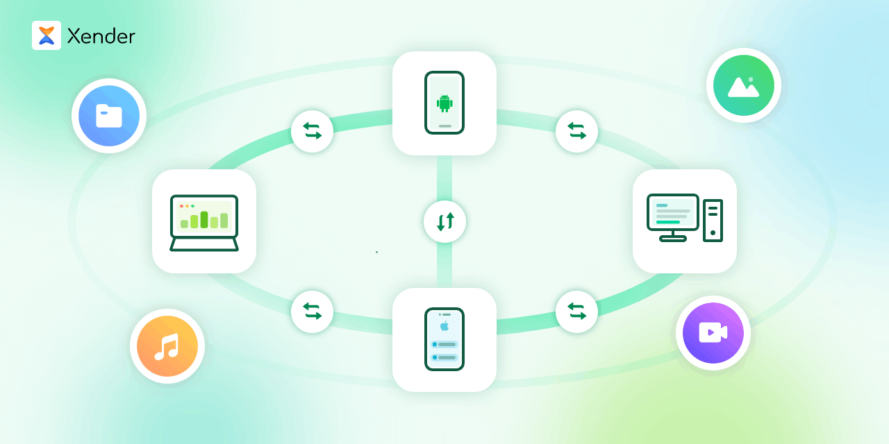

# Xender

## About

Xender is the world-leading cross-platform file transfer app, available on Android, iOS, Windows, macOS, and the web.

Beyond file sharing, it is an all-in-one utility featuring a music and video player, audio converter, social video downloader, and storage cleaner.

Free, fast, compatible, and easy to use.

## Download

| | Android | iOS | Windows | macOS |
|---|---|---|---|---|
| Package | [][Github Release Android] | — | [][Github Release Desktop] | [][Github Release Desktop] |
| Store | [][Google Play] | [][App Store] | [][Microsoft Store] | — |

[Github Release Android]: https://github.com/XenderisBetter/Xender/releases#release-android
[Github Release Desktop]: https://github.com/XenderisBetter/Xender/releases#release-desktop
[Google Play]: https://play.google.com/store/apps/details?id=cn.xender
[App Store]: https://apps.apple.com/app/id898129576
[Microsoft Store]: https://apps.microsoft.com/detail/xp88x47z2x9str

## Features

- Cross-Platform: Supports Android, iOS, Windows, and macOS.
- Multi-Device Compatibility: Works on phones, tablets, laptops, and desktops.
- Wireless Transfer: Share via Wi-Fi and personal hotspot—no cables required.
- Data-Free Sharing: Transfer over local networks with zero cellular data usage.
- Versatile Music Player: Supports lyrics search, playback speed control, volume booster, and sleep timer.
- Powerful Video Player: Supports gesture controls, embedded and external subtitles, audio track switching, rotation lock, screen lock, volume booster, and sleep timer.
- ToMP3 Converter: Quickly extract audio from video files for seamless, off-screen listening.
- Social Video Downloader: Easily save videos for offline play—supports Instagram, Facebook, TikTok, X/Twitter, Threads, Bluesky, Tumblr, and WhatsApp Status (YouTube not supported).
- Storage Cleaner: Free up space by batch-deleting duplicate or similar photos and screenshots.
- And More: New features are on the way.